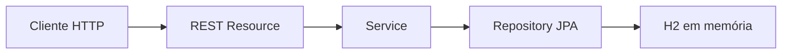

# Nuclear Case — Descubra o que você não vê

**Investigar para compreender a tecnologia nuclear.** O Nuclear Case propõe transformar dúvidas sobre alimentos, saúde e energia em casos de investigação científica, com evidências, decisões e explicações acessíveis.

O Challenge FIAP/Marinha do Brasil 2026 incentiva aproximar a sociedade das aplicações da tecnologia nuclear. Nossa proposta educativa enfrenta a falta de informação e a confusão entre conceitos, contextualizando benefícios e limitações.

**Hoje existe a API REST de gerenciamento de casos, desenvolvida para a Sprint 1 de Java Advanced. O jogo completo é uma visão futura.** A API prepara e organiza o conteúdo que poderá alimentar esse aplicativo.

## Implementado nesta Sprint

- CRUD de `CasoInvestigativo`, com UUID gerado pelo servidor.
- Busca por trecho do título, sem distinguir maiúsculas e minúsculas.
- Bean Validation e erros globais `ProblemDetail`, incluindo rejeição de dificuldade fracionária.
- Swagger/OpenAPI e três casos educativos de demonstração.
- Execução local Java e Docker, com imagem multi-stage validada.

## Arquitetura Java



Docker é uma alternativa de execução da mesma API, não outro backend. O service controla transações e preserva o UUID nas atualizações. [Modelo, camadas e contrato REST](docs/API.md).

**Stack:** Java 21 · Spring Boot 4.1.0 · Maven · Spring Data JPA · H2 · Lombok · Bean Validation · Springdoc OpenAPI 3.1.0.

## Java Advanced: rubrica e evidências

Conforme o PDF V2, páginas 33–36. A pontuação abaixo é o peso dos critérios oficiais, **não uma nota atribuída ao projeto**. No PDF, o critério se chama “Pesquisa”; a busca textual por Query Method é requisito técnico explícito.

| Critério | Peso | Evidência real |
| --- | --- | --- |
| Ideação e aderência ao problema | 40 | Proposta investigativa educativa e [casos do DataLoader](src/main/java/br/com/fiap/tds/tdspa/javaadv/nuclearcase/infrastructure/runner/DataLoader.java) |
| Modelo de dados | 20 | [Entidade CasoInvestigativo](src/main/java/br/com/fiap/tds/tdspa/javaadv/nuclearcase/domainmodel/entities/CasoInvestigativo.java), [Repository](src/main/java/br/com/fiap/tds/tdspa/javaadv/nuclearcase/datasource/repositories/CasoInvestigativoRepository.java) e [CRUD REST](src/main/java/br/com/fiap/tds/tdspa/javaadv/nuclearcase/resources/CasoInvestigativoResource.java) |
| Pesquisa | 10 | `findByTituloContainingIgnoreCase` no Repository; [fontes e ressalvas científicas](docs/API.md#casos-e-responsabilidade-científica) |
| Validation | 10 | [DTO validado](src/main/java/br/com/fiap/tds/tdspa/javaadv/nuclearcase/resources/dtos/CasoInvestigativoRequestDTO.java), `@Valid` e [configuração para rejeitar fracionários](src/main/resources/application.yaml) |
| Qualidade do código e boas práticas | 10 | Camadas separadas, [handler global](src/main/java/br/com/fiap/tds/tdspa/javaadv/nuclearcase/infrastructure/exceptionHandlers/GlobalExceptionHandler.java), [testes](src/test/java) e guias de execução |
| Swagger | 10 | Operações, parâmetros e respostas anotados no Resource; `/swagger-ui.html` e `/api-docs` |

O CRUD usa Spring Data JPA; a entrega inclui fontes, `.gitignore`, configuração, documentação e dados de teste. [Contrato e exemplos](docs/API.md) · [Evidências históricas](docs/EXECUCAO_E_TESTES.md#testes-e-evidências-históricas).

## Comece em 1 minuto

Com **JDK 21 completo** e Maven 3.6.3 ou superior, a partir da raiz do projeto:

```bash
mvn clean verify
mvn spring-boot:run
```

Após a inicialização:

```bash
curl http://localhost:8080/api/casos
```

[Swagger UI](http://localhost:8080/swagger-ui.html) · [OpenAPI JSON](http://localhost:8080/api-docs). No Postman, selecione GET no campo de método e use somente a URL `http://localhost:8080/api/casos`.

O tempo do primeiro build depende do download de dependências. Se 8080 estiver ocupada, preserve o processo existente e escolha outra porta livre, conforme o [guia de execução](docs/EXECUCAO_E_TESTES.md#java-e-maven).

**Alternativa Docker**, com daemon acessível e porta host 8081 livre:

```bash
docker build --pull --no-cache --progress=plain -t nuclear-case-api:local .
docker run -d --name nuclear-case-local --memory=512m --cpus=1 -p 127.0.0.1:8081:8080 nuclear-case-api:local
```

Use [API](http://localhost:8081/api/casos) e [Swagger](http://localhost:8081/swagger-ui.html) na porta 8081. [Logs, parada, remoção e PORT configurável](docs/DEVOPS.md#docker-local-validado).

## Documentação detalhada

| Guia | O que encontrar |
| --- | --- |
| [API](docs/API.md) | Modelo, limites, seis operações, erros, exemplos JSON e casos com referências científicas |
| [Execução e testes](docs/EXECUCAO_E_TESTES.md) | JDK/Maven, JAR, portas, curl, Postman e histórico separado de JUnit/HTTP/aceite manual |
| [Docker e DevOps](docs/DEVOPS.md) | Build/run/stop, runtime sem privilégios, H2 e checklist Cloud pendente |

Os números de validação são históricos e estão nos guias, com datas e naturezas distintas; não representam reexecução durante esta edição da documentação.

## Limitações e evolução

- **H2 volátil:** encerrar a JVM perde as alterações; uma nova instância carrega os três casos iniciais. Não há persistência durável nem console H2 habilitado.
- **Visão futura:** explorar pistas, responder perguntas, receber feedback e acompanhar progresso. Pista, Pergunta e Alternativa não são entidades implementadas.
- **Entregas separadas:** Flutter e modelagem Oracle; integração com esta API não comprovada.
- **Ciência:** exemplos introdutórios sujeitos à revisão editorial humana; não são aconselhamento médico nem garantia de ausência de riscos.
- **DevOps:** Docker local validado; **Azure ainda não implantada**. A prova local não conclui a entrega Cloud.
- Segurança/JWT, IA e gamificação complexa não estão implementadas nesta Sprint.

## Equipe e entrega

| Integrante | RM | Turma |
| --- | --- | --- |
| Murillo Massini | 567383 | 1TDSPA |
| Giovanni Sacristan | 567548 | 1TDSPA |
| Gabriel Deotti Zanatta | 567258 | 1TDSPA |
| Caique Roberto de Souza Hollo | 568104 | 1TDSPA |

Repositório público: [gi13090/nuclear-case-api](https://github.com/gi13090/nuclear-case-api). Vídeo e PDF final de DevOps: **pendentes**. A avaliação acadêmica cabe ao professor.
