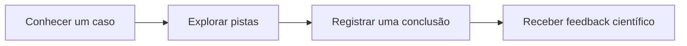
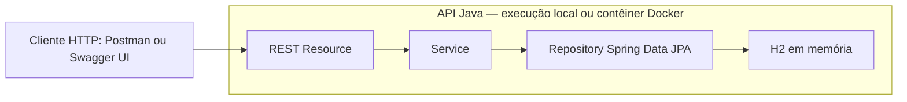

# Nuclear Case — Descubra o que você não vê

**Uma proposta de investigação científica para aproximar as pessoas da tecnologia nuclear.** O Nuclear Case parte de situações do cotidiano — um alimento irradiado, um exame médico, uma decisão sobre energia — para despertar perguntas e contextualizar aplicações, benefícios e limitações dessa tecnologia.

Este repositório contém a **API REST de gerenciamento de casos**, desenvolvida para a primeira Sprint do Challenge FIAP/Marinha do Brasil 2026, na disciplina Java Advanced. O backend prepara o conteúdo que poderá alimentar um futuro jogo educativo; **o jogo completo ainda não está implementado**.

## O desafio e a ideia do produto

O Challenge propõe tornar a tecnologia nuclear mais compreensível, acessível e envolvente para a sociedade. A proposta do Nuclear Case é transformar dúvidas em investigações: apresentar uma situação, permitir a análise de evidências e explicar o raciocínio científico por trás da conclusão.

A jornada abaixo é uma **visão futura do produto**, não um fluxo já disponível nesta API:



### O que funciona nesta Sprint

- Cadastro, listagem, consulta, atualização completa e exclusão de casos investigativos.
- Pesquisa por trecho do título, sem distinguir maiúsculas e minúsculas.
- Validação dos dados, respostas de erro padronizadas e documentação interativa.
- Três casos educativos de demonstração e execução local com Java ou Docker.

O CRUD permite preparar e revisar título, descrição, categoria, dificuldade e explicação científica de cada investigação. Essa é a contribuição concreta da API para o futuro catálogo do aplicativo.

Pistas, perguntas, alternativas, resolução do jogador, progresso e feedback interativo são **evoluções previstas**. Flutter, modelagem Oracle e trabalhos de outras disciplinas são entregas separadas; sua integração com esta API não está comprovada neste repositório. A API usa H2, sem integração Oracle.

## Arquitetura atual



O resource recebe e valida DTOs; o service conduz as operações e transações; o repository realiza a persistência. A atualização carrega a entidade existente e preserva seu UUID. O H2 pertence à execução da aplicação, sem serviço de banco externo.

**Tecnologias:** Java 21, Spring Boot 4.1.0, Maven, Spring MVC, Spring Data JPA, Bean Validation, Lombok, H2 e Springdoc OpenAPI 3.1.0. Configuração em [application.yaml](src/main/resources/application.yaml).

| Pacote | Responsabilidade |
| --- | --- |
| `domainmodel.entities` | Entidade JPA `CasoInvestigativo` |
| `datasource.repositories` | Persistência e Query Method textual |
| `services` | Interface e implementação do serviço, transações e verificação de existência |
| `resources` e `resources.dtos` | Contrato HTTP, entrada validada e DTO de resposta |
| `infrastructure.exceptionHandlers` e `infrastructure.exceptions` | Tratamento global com `ProblemDetail` |
| `infrastructure.configuration` e `infrastructure.runner` | OpenAPI e carga de demonstração |

## Modelo de dados

A entidade implementada é [CasoInvestigativo](src/main/java/br/com/fiap/tds/tdspa/javaadv/nuclearcase/domainmodel/entities/CasoInvestigativo.java). O contrato de entrada está em [CasoInvestigativoRequestDTO](src/main/java/br/com/fiap/tds/tdspa/javaadv/nuclearcase/resources/dtos/CasoInvestigativoRequestDTO.java).

| Campo | Tipo Java | Obrigatoriedade e limite |
| --- | --- | --- |
| `id` | `UUID` | Gerado pelo servidor; não é enviado no corpo de entrada |
| `titulo` | `String` | Obrigatório, não pode estar em branco; até 150 caracteres |
| `descricao` | `String` | Obrigatória, não pode estar em branco; até 1000 caracteres |
| `categoria` | `String` | Texto obrigatório, não pode estar em branco; até 50 caracteres |
| `dificuldade` | `Integer` | Obrigatória, de 1 a 5; números fracionários são rejeitados |
| `explicacaoCientifica` | `String` | Obrigatória, não pode estar em branco; até 2000 caracteres |

POST e PUT recebem os mesmos cinco campos de conteúdo. A resposta acrescenta o UUID. Categoria é texto livre, não um enum. Não existem entidades de pistas ou perguntas nesta implementação.

**Persistência da prova de conceito:** o H2 é mantido em memória, com esquema `create-drop`. Encerrar a JVM perde as alterações; a próxima inicialização carrega novamente os três casos. O console H2 está desabilitado.

## Java Advanced: requisito e evidência

Conferência baseada nas páginas 33–36 do documento oficial **2TDS Agosto — Marinha 2026 — 1º Semestre V2**. A tabela relaciona a implementação aos requisitos; não representa nota concedida.

| Requisito | Evidência no projeto |
| --- | --- |
| Solução educativa e coerente com tecnologia nuclear | Proposta investigativa, `CasoInvestigativo` e três exemplos no `DataLoader` |
| CRUD com Spring Data JPA de pelo menos uma entidade | `CasoInvestigativoRepository`, `CasoInvestigativoServiceImpl` e `CasoInvestigativoResource` |
| Busca textual por Query Method | `findByTituloContainingIgnoreCase` em [CasoInvestigativoRepository](src/main/java/br/com/fiap/tds/tdspa/javaadv/nuclearcase/datasource/repositories/CasoInvestigativoRepository.java) |
| Spring Validation | Constraints no DTO e `@Valid` no resource; rejeição de dificuldade fracionária no YAML |
| Tratamento global de exceções | [GlobalExceptionHandler](src/main/java/br/com/fiap/tds/tdspa/javaadv/nuclearcase/infrastructure/exceptionHandlers/GlobalExceptionHandler.java), com erros 400/404 e resposta genérica 500 |
| Swagger/OpenAPI: endpoints, parâmetros e respostas | Anotações em [CasoInvestigativoResource](src/main/java/br/com/fiap/tds/tdspa/javaadv/nuclearcase/resources/CasoInvestigativoResource.java) e `/api-docs` |
| Qualidade e organização | Camadas separadas, DTOs, injeção por construtor e testes em [src/test/java](src/test/java) |
| Repositório, instruções, configurações e dados de teste | Este README, `.gitignore`, `pom.xml`, YAML e [DataLoader](src/main/java/br/com/fiap/tds/tdspa/javaadv/nuclearcase/infrastructure/runner/DataLoader.java) |
| Pesquisa e responsabilidade científica | Referências institucionais na seção de casos; revisão editorial humana final pendente |

A rubrica atribui **40 pontos à ideação**, **20 ao modelo de dados**, **10 à pesquisa**, **10 à Validation**, **10 à qualidade do código e boas práticas** e **10 ao Swagger**. As evidências técnicas não substituem a avaliação do professor nem a curadoria científica.

## Contrato REST

URL base local: `http://localhost:8080`. Pelo Docker descrito abaixo, use `http://localhost:8081`.

| Método | Endpoint | Respostas usuais |
| --- | --- | --- |
| GET | `/api/casos` | 200 com lista, inclusive `[]` |
| GET | `/api/casos/{id}` | 200; 400 para UUID inválido; 404 se inexistente |
| GET | `/api/casos/buscar?titulo=alimento` | 200 com lista; 400 para parâmetro ausente ou inválido |
| POST | `/api/casos` | 201 com corpo e `Location`; 400 para entrada inválida |
| PUT | `/api/casos/{id}` | 200 com UUID preservado; 400 para entrada inválida; 404 se inexistente |
| DELETE | `/api/casos/{id}` | 204 sem corpo; 400 para UUID inválido; 404 se inexistente |

A busca aceita título não vazio de até 150 caracteres, remove espaços nas extremidades e ignora diferenças entre maiúsculas e minúsculas. Busca sem correspondência retorna `200` com `[]`.

Os erros usam `application/problem+json` (`ProblemDetail`); falhas de validação de campos incluem o mapa `errors`. Falhas inesperadas retornam `500` com mensagem genérica, sem expor stack trace na resposta.

### Exemplo de cadastro e consulta

```bash
curl -i -X POST http://localhost:8080/api/casos \
  -H 'Content-Type: application/json' \
  -d '{"titulo":"Investigação educativa","descricao":"Analise as evidências do caso.","categoria":"ENERGIA","dificuldade":2,"explicacaoCientifica":"Texto educativo em revisão pela equipe."}'

curl http://localhost:8080/api/casos
curl 'http://localhost:8080/api/casos/buscar?titulo=alimento'
```

Copie o `id` retornado e substitua `SEU_UUID` nos comandos seguintes:

```bash
curl http://localhost:8080/api/casos/SEU_UUID

curl -X PUT http://localhost:8080/api/casos/SEU_UUID \
  -H 'Content-Type: application/json' \
  -d '{"titulo":"Investigação revisada","descricao":"Analise novas evidências.","categoria":"ENERGIA","dificuldade":3,"explicacaoCientifica":"Texto educativo revisado pela equipe."}'

curl -i -X DELETE http://localhost:8080/api/casos/SEU_UUID
```

### Exemplos de entrada inválida

Este JSON enviado por POST ou PUT retorna **400**: `2.7` não é convertido silenciosamente em `2`, nem é gravado. Em PUT, os dados anteriores são preservados.

```json
{
  "titulo": "Teste de validação",
  "descricao": "Verificação de entrada inválida.",
  "categoria": "ENERGIA",
  "dificuldade": 2.7,
  "explicacaoCientifica": "Texto de teste."
}
```

Título em branco, dificuldade nula/fora de 1–5 e textos acima dos limites também retornam 400. Um GET em `/api/casos/nao-e-uuid` retorna 400; um UUID válido sem registro retorna 404.

**No Postman:** selecione o método no campo próprio e informe somente a URL, por exemplo `http://localhost:8080/api/casos`. Para POST/PUT, use corpo raw JSON e `Content-Type: application/json`.

## Como executar

### Java e Maven

Requisitos: **JDK 21 completo**, com `java` e `javac`, e Maven 3.6.3 ou superior. Configure `JAVA_HOME` e confira `java -version`, `javac -version` e `mvn -version`.

```bash
mvn clean verify
mvn spring-boot:run
```

Ou execute o JAR após o build:

```bash
java -jar target/nuclear-case-api-0.0.1-SNAPSHOT.jar
```

- Swagger UI: http://localhost:8080/swagger-ui.html
- OpenAPI JSON: http://localhost:8080/api-docs
- `/` não possui endpoint; um 404 nessa URL é esperado.

Se 8080 já estiver ocupada, preserve a aplicação existente e escolha outra porta livre. Em Linux/macOS, por exemplo:

```bash
PORT=8081 java -jar target/nuclear-case-api-0.0.1-SNAPSHOT.jar
```

Nesse caso, use 8081 nas URLs. A configuração está no YAML; não é necessário editar o código.

### Docker local

Com Docker instalado e daemon acessível, confira `docker info`. No Docker Desktop para Linux, `desktop-linux` pode ser o contexto adequado; essa configuração é específica do ambiente, não uma obrigação em toda instalação.

O [Dockerfile](Dockerfile) usa Maven 3.9.11/JDK 21 no build e JRE 21 no runtime, com bases fixadas por digest. Executa `clean verify` com todos os testes, sem usar o JDK, cache Maven ou `target/` do host. Na validação de 22/10/2026, o build usou Temurin 21.0.9 e o runtime 21.0.12.1. Alterações nos digests exigem nova validação.

```bash
docker build --pull --no-cache --progress=plain -t nuclear-case-api:local .

docker run -d --name nuclear-case-local \
  --memory=512m --cpus=1 \
  -p 127.0.0.1:8081:8080 \
  nuclear-case-api:local
```

Use 8081 somente se estiver livre. Esse mapeamento preserva a porta 8080 do host; a aplicação escuta na porta interna 8080. A [.dockerignore](.dockerignore) limita o contexto aos arquivos necessários ao build.

Após inicializar: [casos](http://localhost:8081/api/casos), [busca](http://localhost:8081/api/casos/buscar?titulo=alimento), [Swagger](http://localhost:8081/swagger-ui.html) e [OpenAPI](http://localhost:8081/api-docs). Os exemplos curl anteriores podem ser usados trocando a porta para 8081.

```bash
docker logs nuclear-case-local
docker exec nuclear-case-local java -version
docker stop --time 30 nuclear-case-local
docker rm nuclear-case-local
```

Pare/remova somente o contêiner que você criou. O runtime usa o usuário sem privilégios `10001:10001`, Java como processo principal e encerramento gracioso por SIGTERM. A imagem local permanece disponível.

Para alterar também a porta interna com `PORT`, ajuste o mapeamento e escolha uma porta host livre:

```bash
docker run -d --name nuclear-case-alt \
  --memory=512m --cpus=1 \
  -e PORT=8082 -p 127.0.0.1:8082:8082 \
  nuclear-case-api:local

docker logs nuclear-case-alt
docker stop --time 30 nuclear-case-alt
docker rm nuclear-case-alt
```

O build precisa de acesso ao registry e ao Maven Central na primeira construção. O H2 continua descartável no contêiner: uma nova JVM restaura os três casos, sem manter alterações da execução anterior. Não há volume de banco nem persistência externa.

## Testes e evidências

Os testes automatizados estão em [CasoInvestigativoCrudTests](src/test/java/br/com/fiap/tds/tdspa/javaadv/nuclearcase/CasoInvestigativoCrudTests.java) e [NuclearCaseApplicationTests](src/test/java/br/com/fiap/tds/tdspa/javaadv/nuclearcase/NuclearCaseApplicationTests.java). Cobrem JPA/UUID, limites dos DTOs, CRUD HTTP, busca, 400/404, documentação, carga sem duplicação e rejeição de dificuldade fracionária. O teste de resposta genérica 500 é direto no handler, sem endpoint artificial de falha.

| Data | Execução histórica | Resultado |
| --- | --- | --- |
| 20/10/2026 | Java: build limpo, auditoria HTTP do JAR com reinício e nova regressão limpa | 30 testes JUnit; 43 verificações HTTP/encerramento; 30 testes JUnit, respectivamente |
| 22/10/2026 | Docker: build da imagem, primeiro contêiner e novo contêiner limpo | 30 testes JUnit no build; 33 verificações HTTP/infraestrutura; 36 verificações de regressão/infraestrutura |
| 25/10/2026 | Postman | Aceite dos testes manuais relatado pelo usuário; não é execução produzida pela auditoria automatizada |

As sequências finais registradas passaram sem falhas. **As contagens têm naturezas diferentes e não devem ser somadas como testes automatizados.** São evidências históricas; a revisão deste README não representa reexecução dessas rodadas. Para uma nova validação, execute os comandos de build/teste acima. Os testes HTTP precisam permitir conexões locais e usam porta aleatória.

## Casos e responsabilidade científica

O [DataLoader](src/main/java/br/com/fiap/tds/tdspa/javaadv/nuclearcase/infrastructure/runner/DataLoader.java) insere os três exemplos abaixo quando a tabela está vazia. A carga é transacional, não duplica registros se já houver dados e não concorre com outro mecanismo como `data.sql`.

| Caso implementado | Tema investigativo | Referências institucionais |
| --- | --- | --- |
| O alimento irradiado | Diferença entre exposição à radiação e contaminação radioativa | [IAEA — aplicações de instalações gama](https://nucleus.iaea.org/sites/diif/Pages/GammaRT.aspx), [FDA — irradiação de alimentos](https://www.fda.gov/food/buy-store-serve-safe-food/food-irradiation-what-you-need-know) |
| O segredo do diagnóstico | Radiofármacos e informações sobre o funcionamento de órgãos | [IAEA — proteção de pacientes](https://gnssn.iaea.org/CSN/Toolbox%20Wiki%20temp/Radiation%20Protection%20of%20Patients.aspx), [IAEA — produção e disponibilidade de radiofármacos](https://www.iaea.org/sites/default/files/gc/gc51inf-3-att2_en.pdf) |
| O futuro energético | Geração nuclear, resíduos, segurança e custos ao longo do ciclo de vida | [IAEA — ciência da energia nuclear](https://www.iaea.org/newscenter/news/what-is-nuclear-energy-the-science-of-nuclear-power), [IAEA — avaliação econômica](https://nucleus.iaea.org/sites/connect/MSNpublic/Pages/nct/site/bid/evaluate/economic.html) |

As fontes apoiam conceitos introdutórios, não uma aprovação científica final dos textos. Os exemplos continuam sujeitos à revisão editorial humana. Irradiação alimentar não deve ser confundida com contaminação; aplicações médicas exigem avaliação profissional de benefícios e riscos. A referência econômica não substitui fontes específicas sobre segurança. O projeto não oferece aconselhamento médico nem afirma ausência universal de riscos.

## Evolução prevista e entregas relacionadas

| Frente | Situação |
| --- | --- |
| Java Advanced | CRUD educativo e requisitos técnicos implementados; avaliação acadêmica cabe ao professor |
| Docker | Build e execução local validados; comandos disponíveis acima |
| Produto educativo | Pistas, perguntas, alternativas, conclusão do jogador, feedback e progresso são futuros |
| Mobile e Banco de Dados | Flutter e modelagem Oracle são entregas separadas; integração ainda não demonstrada aqui |
| Persistência durável | Evolução futura; atualmente H2 em memória |
| Segurança, IA e gamificação complexa | Não implementadas nesta Sprint |

**DevOps ainda não está concluído.** Conforme as páginas 24–28 da V2, faltam VM provisionada por Azure CLI, contêiner funcionando na VM, script `.sh`, comprovação da exclusão do grupo de recursos, diagrama específico com ícones/serviços, instruções Cloud, vídeo de aproximadamente 3 minutos (mínimo 720p) e PDF final com identificação e links. O diagrama técnico deste README explica o backend; não substitui esse desenho de implantação. Docker local, isoladamente, não atende à entrega Cloud. **Azure não foi implantada.**

## Equipe e entrega

| Integrante | RM | Turma |
| --- | --- | --- |
| Murillo Massini | 567383 | 1TDSPA |
| Giovanni Sacristan | 567548 | 1TDSPA |
| Gabriel Deotti Zanatta | 567258 | 1TDSPA |
| Caique Roberto de Souza Hollo | 568104 | 1TDSPA |

- Repositório público: [gi13090/nuclear-case-api](https://github.com/gi13090/nuclear-case-api).
- Links de vídeo e PDF final de DevOps: **pendentes**.

O README documenta a prova de conceito existente. A evolução do jogo, a curadoria científica e as entregas de outras disciplinas precisam ser revisadas pela equipe em seus respectivos escopos.
