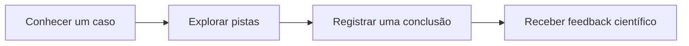

# API — contrato, modelo e conteúdo educativo

[Voltar ao README](../README.md) · [Execução e testes](EXECUCAO_E_TESTES.md) · [Docker e DevOps](DEVOPS.md)

## Modelo de dados

A entidade implementada é [CasoInvestigativo](../src/main/java/br/com/fiap/tds/tdspa/javaadv/nuclearcase/domainmodel/entities/CasoInvestigativo.java). O contrato de entrada está em [CasoInvestigativoRequestDTO](../src/main/java/br/com/fiap/tds/tdspa/javaadv/nuclearcase/resources/dtos/CasoInvestigativoRequestDTO.java).

| Campo | Tipo Java | Obrigatoriedade e limite |
| --- | --- | --- |
| `id` | `UUID` | Gerado pelo servidor; não é enviado no corpo de entrada |
| `titulo` | `String` | Obrigatório, não pode estar em branco; até 150 caracteres |
| `descricao` | `String` | Obrigatória, não pode estar em branco; até 1000 caracteres |
| `categoria` | `String` | Texto obrigatório, não pode estar em branco; até 50 caracteres |
| `dificuldade` | `Integer` | Obrigatória, de 1 a 5; números fracionários são rejeitados |
| `explicacaoCientifica` | `String` | Obrigatória, não pode estar em branco; até 2000 caracteres |

POST e PUT recebem os mesmos cinco campos de conteúdo. A resposta acrescenta o UUID. Categoria é texto livre, não um enum. Não existem entidades de pistas ou perguntas nesta implementação.

**Persistência da prova de conceito:** o H2 é mantido em memória, com esquema `create-drop`. Encerrar a JVM perde as alterações; a próxima inicialização carrega novamente os três casos. O console H2 está desabilitado.

## Contrato REST

URL base local: `http://localhost:8080`. Com o [Docker local](DEVOPS.md), use `http://localhost:8081`.

| Método | Endpoint | Respostas usuais |
| --- | --- | --- |
| GET | `/api/casos` | 200 com lista, inclusive `[]` |
| GET | `/api/casos/{id}` | 200; 400 para UUID inválido; 404 se inexistente |
| GET | `/api/casos/buscar?titulo=alimento` | 200 com lista; 400 para parâmetro ausente ou inválido |
| POST | `/api/casos` | 201 com corpo e `Location`; 400 para entrada inválida |
| PUT | `/api/casos/{id}` | 200 com UUID preservado; 400 para entrada inválida; 404 se inexistente |
| DELETE | `/api/casos/{id}` | 204 sem corpo; 400 para UUID inválido; 404 se inexistente |

A busca aceita título não vazio de até 150 caracteres, remove espaços nas extremidades e ignora diferenças entre maiúsculas e minúsculas. Busca sem correspondência retorna `200` com `[]`.

Os erros usam `application/problem+json` (`ProblemDetail`); falhas de validação de campos incluem o mapa `errors`. Falhas inesperadas retornam `500` com mensagem genérica, sem expor stack trace na resposta.

## Corpo válido de POST e PUT

Exemplo de entrada; o servidor acrescenta o `id` na resposta. Os comandos curl completos estão no [guia de execução](EXECUCAO_E_TESTES.md#exercitar-o-crud).

```json
{
  "titulo": "Investigação educativa",
  "descricao": "Analise as evidências do caso.",
  "categoria": "ENERGIA",
  "dificuldade": 2,
  "explicacaoCientifica": "Texto educativo em revisão pela equipe."
}
```

## Entradas inválidas

Este JSON enviado por POST ou PUT retorna **400**: `2.7` não é convertido silenciosamente em `2`, nem é gravado. Em PUT, os dados anteriores são preservados.

```json
{
  "titulo": "Teste de validação",
  "descricao": "Verificação de entrada inválida.",
  "categoria": "ENERGIA",
  "dificuldade": 2.7,
  "explicacaoCientifica": "Texto de teste."
}
```

Título em branco, dificuldade nula/fora de 1–5 e textos acima dos limites também retornam 400. Um GET em `/api/casos/nao-e-uuid` retorna 400; um UUID válido sem registro retorna 404.

## Organização Java

| Pacote | Responsabilidade |
| --- | --- |
| `domainmodel.entities` | Entidade JPA `CasoInvestigativo` |
| `datasource.repositories` | Persistência e Query Method textual |
| `services` | Interface e implementação do serviço, transações e verificação de existência |
| `resources` e `resources.dtos` | Contrato HTTP, entrada validada e DTO de resposta |
| `infrastructure.exceptionHandlers` e `infrastructure.exceptions` | Tratamento global com `ProblemDetail` |
| `infrastructure.configuration` e `infrastructure.runner` | OpenAPI e carga de demonstração |

O resource recebe DTOs com `@Valid`; o service verifica existência e controla transações; o repository persiste via JPA. O PUT carrega e altera a entidade existente, preservando seu UUID. As entidades não são retornadas diretamente como contrato HTTP.

## Casos e responsabilidade científica

O [DataLoader](../src/main/java/br/com/fiap/tds/tdspa/javaadv/nuclearcase/infrastructure/runner/DataLoader.java) insere os três exemplos abaixo quando a tabela está vazia. A carga é transacional, não duplica registros se já houver dados e não concorre com outro mecanismo como `data.sql`.

| Caso implementado | Tema investigativo | Referências institucionais |
| --- | --- | --- |
| O alimento irradiado | Diferença entre exposição à radiação e contaminação radioativa | [IAEA — aplicações de instalações gama](https://nucleus.iaea.org/sites/diif/Pages/GammaRT.aspx), [FDA — irradiação de alimentos](https://www.fda.gov/food/buy-store-serve-safe-food/food-irradiation-what-you-need-know) |
| O segredo do diagnóstico | Radiofármacos e informações sobre o funcionamento de órgãos | [IAEA — proteção de pacientes](https://gnssn.iaea.org/CSN/Toolbox%20Wiki%20temp/Radiation%20Protection%20of%20Patients.aspx), [IAEA — produção e disponibilidade de radiofármacos](https://www.iaea.org/sites/default/files/gc/gc51inf-3-att2_en.pdf) |
| O futuro energético | Geração nuclear, resíduos, segurança e custos ao longo do ciclo de vida | [IAEA — ciência da energia nuclear](https://www.iaea.org/newscenter/news/what-is-nuclear-energy-the-science-of-nuclear-power), [IAEA — avaliação econômica](https://nucleus.iaea.org/sites/connect/MSNpublic/Pages/nct/site/bid/evaluate/economic.html) |

As fontes apoiam conceitos introdutórios, não uma aprovação científica final dos textos. Os exemplos continuam sujeitos à revisão editorial humana. Irradiação alimentar não deve ser confundida com contaminação; aplicações médicas exigem avaliação profissional de benefícios e riscos. A referência econômica não substitui fontes específicas sobre segurança. O projeto não oferece aconselhamento médico nem afirma ausência universal de riscos.

## Jornada do produto — visão futura

O Challenge propõe tornar a tecnologia nuclear mais compreensível, acessível e envolvente para a sociedade. A proposta do Nuclear Case é transformar dúvidas em investigações: apresentar uma situação, permitir a análise de evidências e explicar o raciocínio científico por trás da conclusão.

A jornada abaixo é uma **visão futura do produto**, não um fluxo já disponível nesta API:



Explorar pistas, registrar conclusões e receber feedback interativo ainda não são operações desta API. Pistas, perguntas e alternativas não são entidades implementadas. O backend atual prepara o conteúdo do futuro catálogo.
