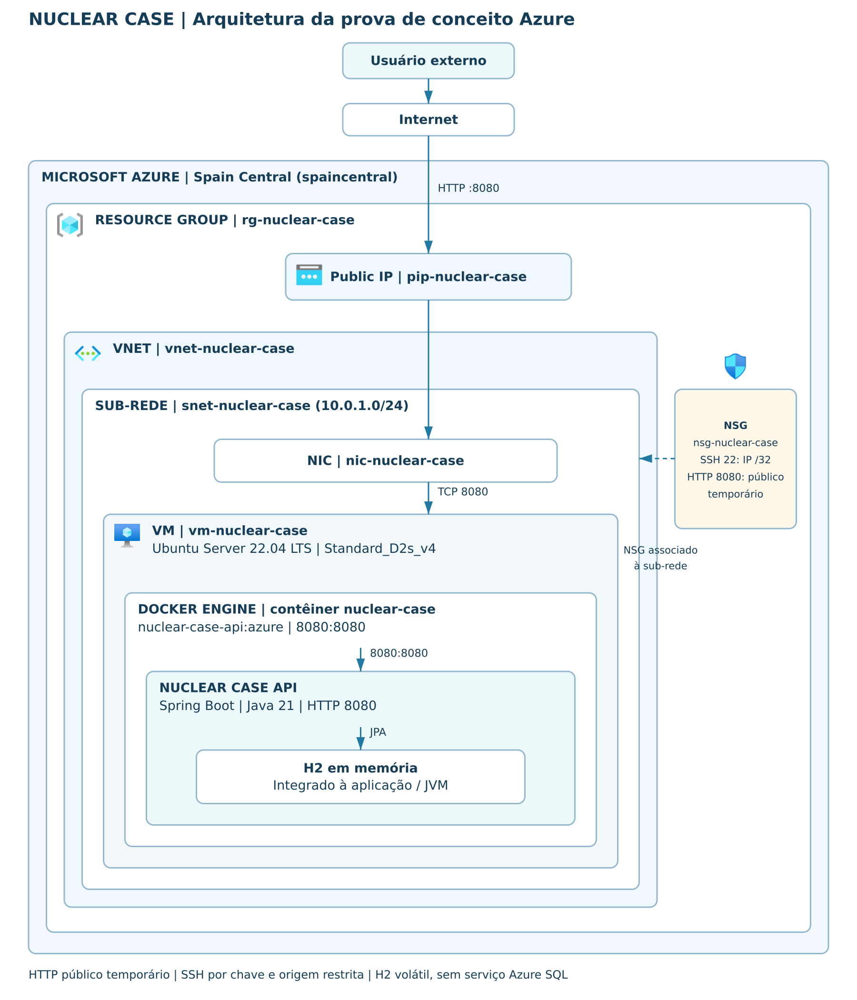

# Arquitetura DevOps revisada

[PNG para visualização](nuclear-case-azure.png) · [Arquivo editável draw.io](nuclear-case-azure.drawio)

O original `nuclear-case-api-azure(1).drawio` foi fornecido pelo usuário em 31/10/2026 e preservado fora do repositório. A cópia foi revisada para incluir usuário externo, NIC, sub-rede, nomes reais, região e SKU; representar o NSG como controle associado à sub-rede; e mostrar a comunicação até a API e o H2 interno à JVM.

A sub-rede `10.0.1.0/24` e a associação ao NSG são confirmadas pela captura de 30/10. O H2 é volátil, não é Azure SQL e não representa um serviço Azure independente. A porta 8080 foi liberada temporariamente, e SSH 22 ficou restrita a IPv4/32.

Os cinco ícones da família Azure foram obtidos da biblioteca do draw.io (repositório `jgraph/drawio`, arquivos Resource_Groups, Virtual_Networks, Network_Security_Groups, Public_IP_Addresses e Virtual_Machine). Foram incorporados ao editável, evitando dependência de caminhos relativos de imagens. Referências: [biblioteca draw.io](https://github.com/jgraph/drawio/tree/dev/src/main/webapp/img/lib/azure2) e [orientações oficiais Azure](https://learn.microsoft.com/en-us/azure/architecture/icons/).

PNG renderizado a partir dos mesmos rótulos, nós, coordenadas e ícones da cópia revisada, em 1800×2100; conferido visualmente. XML editável conferido estruturalmente; a abertura no aplicativo draw.io ainda deve ser conferida pelo usuário. Nenhuma infraestrutura foi consultada ou modificada para produzir o desenho.

[Guia DevOps](../DEVOPS.md)
